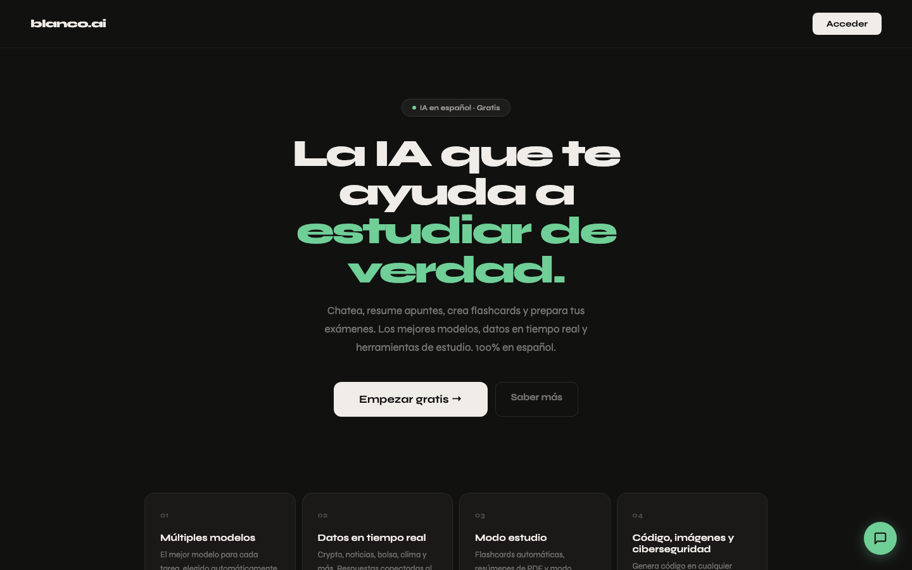
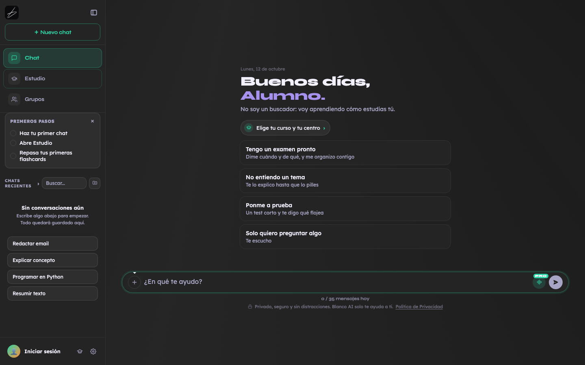
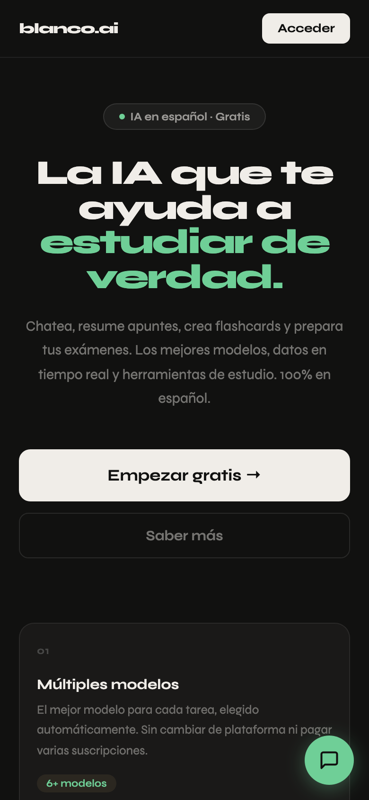

# Blanco AI

**La IA que te ayuda a estudiar de verdad.** Un asistente en español pensado para estudiantes: chatea, resume apuntes,
crea flashcards, prepara exámenes y repasa contigo.

[**Probar Blanco AI → blancoai.app**](https://blancoai.app)

> Este repositorio es un **escaparate**: enseña el proyecto, no contiene su código. El código de Blanco AI es privado.

## Qué hace

- **Chat con IA en español**: elige solo el modelo adecuado para cada pregunta, busca en internet cuando hace falta (con
  sus fuentes) y hace las cuentas con una calculadora exacta en vez de "de cabeza".
- **Modo Estudio**: un profe que explica hasta que lo pillas, flashcards con repaso espaciado, exámenes de práctica
  corregidos y un panel con lo que llevas flojo.
- **Se acuerda de ti**: tu nombre, tu curso y cómo estudias, en todos tus dispositivos.
- **Grupos**: salas para estudiar con tus amigos, con Blanco dentro (@Blanco) y llamadas de voz.
- **Modo conversación**: hablar con Blanco en tiempo real, como en una llamada.
- **Blanco te llama**: te llama a la hora que elijas para repasar lo de tu próximo examen.
- **Archivos**: lee PDF, Word y fotos de apuntes, y te devuelve resúmenes, esquemas o documentos de Word y PDF.
- **Código**: vista previa en vivo de HTML, CSS, JavaScript y React, y archivos de Packet Tracer.
- **App instalable** en el móvil (PWA), con modo claro y oscuro.

  

  

## Planes

| Gratis | Study | Pro |
|---|---|---|
| 35 mensajes al día | Modo Estudio sin límite · 2,99 €/mes | Todo sin límite, los mejores modelos, voz e imágenes · 4,69 €/mes |

Pago mensual o anual (2 meses gratis). Los planes de pago se abren el 15 de diciembre de 2026.

## Cómo está hecho

- **Backend:** Node.js + Express, PostgreSQL (con pgvector para buscar en tus documentos).
- **Frontend:** JavaScript sin frameworks, como PWA instalable.
- **IA:** modelos de OpenAI (el principal, "Luna") con respaldo de otros proveedores si uno falla.
- **Infraestructura:** Railway + Cloudflare, pagos con Stripe, copias de seguridad automáticas cada noche y pruebas
  automáticas en cada cambio.
- **Seguridad:** cuentas con código por correo, datos de cada cuenta separados en el servidor y revisiones de seguridad
  periódicas.

## Autor

Hecho por **Carlos** ([@bblanncooo](https://github.com/bblanncooo)), desde Madrid.

---

© 2026 Blanco AI. Todos los derechos reservados. Las capturas y textos de este repositorio no se pueden reutilizar sin
permiso.
