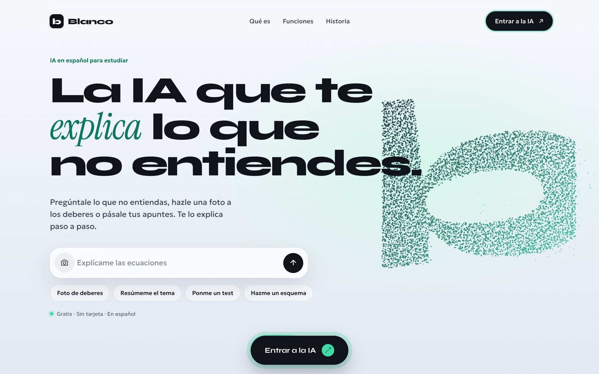
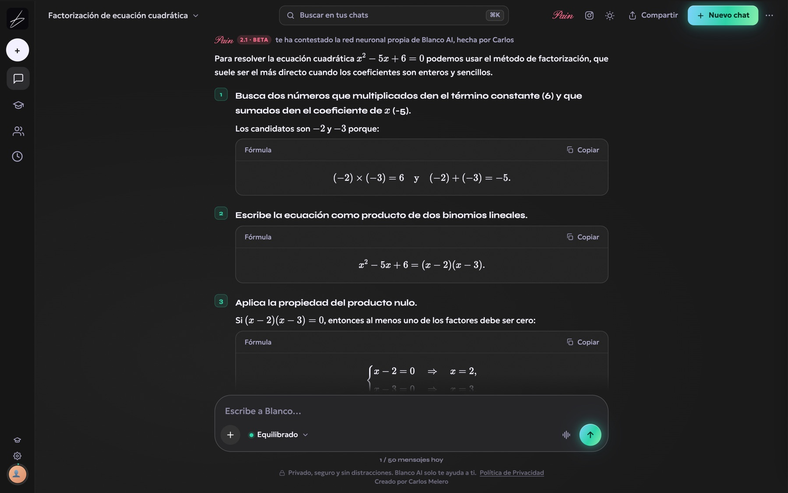
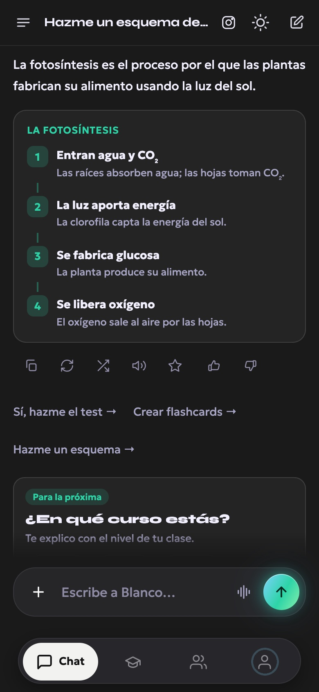
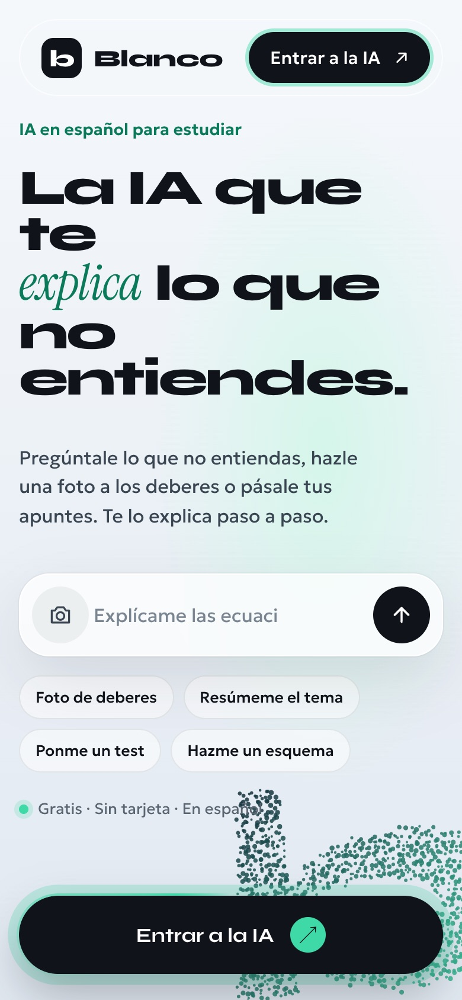
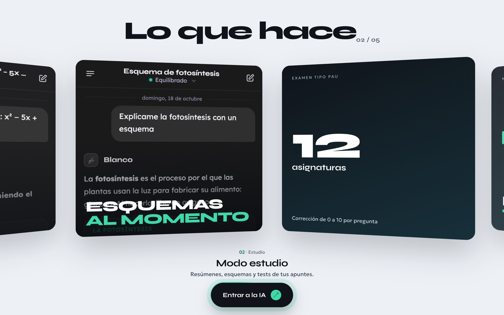
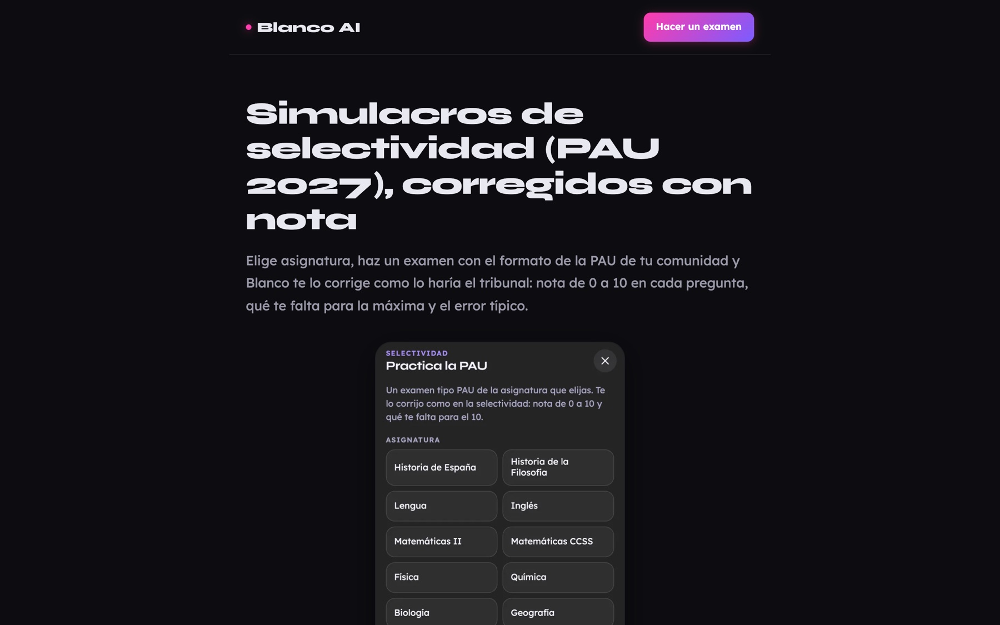
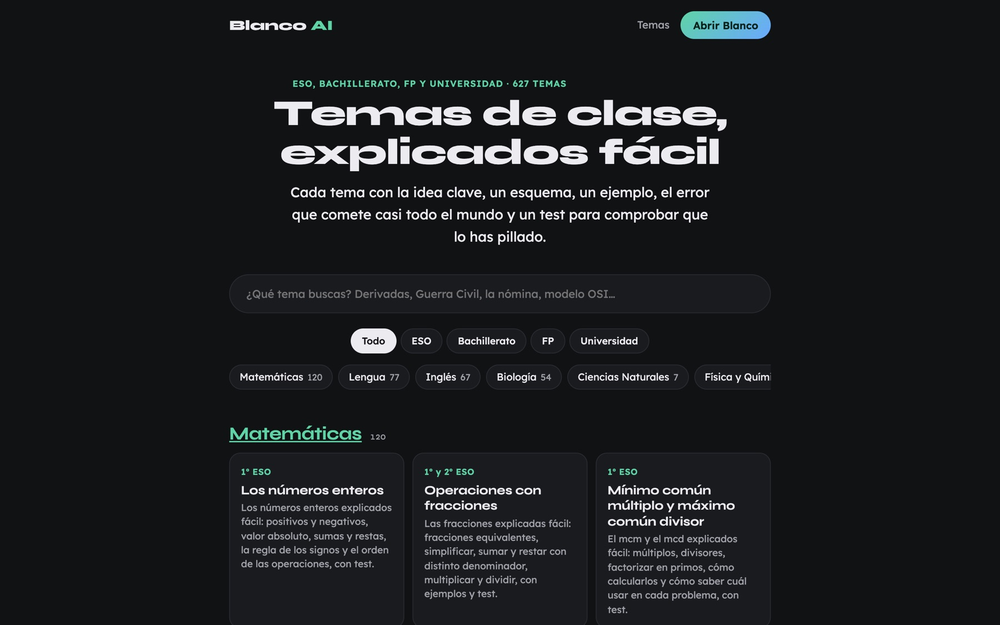

# Blanco AI

**La IA que te explica lo que no entiendes.** Una IA en español para estudiar: le haces una foto a los deberes y te lo
explica paso a paso, convierte tus apuntes en esquemas y tests, te prepara la selectividad y puedes hablar con ella en
voz alta.

[**Probar Blanco AI gratis → blancoai.app**](https://blancoai.app)

> Este repositorio es un **escaparate**: enseña el proyecto, no contiene su código. El código de Blanco AI es privado.

## La IA, por dentro

Una pregunta de verdad, con la respuesta tal cual la da Blanco: paso a paso, sin soltar solo la solución.

  
  &nbsp;&nbsp;
  

## Qué hace

- **Foto de deberes**: lee el ejercicio y te lo explica paso a paso, con dibujos y esquemas cuando hace falta.
- **Modo Estudio**: esquemas, resúmenes, tests y flashcards de tus propios apuntes (PDF, Word o fotos), con repaso
  espaciado y un panel con lo que llevas flojo.
- **Selectividad**: exámenes tipo PAU de 12 asignaturas, corregidos de 0 a 10 pregunta a pregunta, como el tribunal.
- **Habla con Blanco**: conversación por voz en tiempo real, y un profe que mira por la cámara el ejercicio que tienes
  delante y te guía.
- **Blanco te llama**: a la hora que elijas, para repasar lo de tu próximo examen.
- **Se acuerda de ti**: tu curso, lo que te cuesta y cómo te gusta que te expliquen, en todos tus dispositivos.
- **Grupos y concurso en directo**: salas para estudiar con tus amigos, con Blanco dentro, y concursos tipo quiz con
  tus apuntes para toda la clase.
- **Pain**: el modelo propio de Blanco, sobre un modelo de pesos abiertos, que aprende de sus propias prácticas y
  contesta cada vez más preguntas sin depender de los grandes proveedores.
- **Temas de clase gratis**: cientos de temas de ESO y Bachillerato explicados, con su test, abiertos para todos.
- **App instalable** en el móvil, con modo claro y oscuro.

  
  

## Planes

| Gratis | Study | Pro |
|---|---|---|
| 50 mensajes al día en el chat, 35 en Modo Estudio y 3 fotos, sin tarjeta | Modo Estudio sin límite · 2,99 €/mes | Todo sin límite, los mejores modelos, voz e imágenes · 4,69 €/mes |

Pago mensual o anual (2 meses gratis). La versión completa y los planes de pago se abren el **15 de diciembre de 2026**.

## Cómo está hecho

- **Backend:** Node.js + Express, PostgreSQL (con pgvector para buscar en tus documentos).
- **Frontend:** JavaScript sin frameworks, como app instalable (PWA).
- **IA:** varios proveedores de modelos con respaldo automático si uno falla, y Pain, el modelo propio, para las
  preguntas que ya sabe contestar.
- **Infraestructura:** Railway + Cloudflare, pagos con Stripe y más de 500 pruebas automáticas antes de cada cambio.
- **Seguridad:** cuentas con código por correo, datos de cada cuenta separados en el servidor y revisiones de seguridad
  periódicas.

## Autor

Hecho por **Carlos Melero** ([@bblanncooo](https://github.com/bblanncooo)), 17 años, desde Madrid. Empezó en mayo de
2026 y lo ha construido entero él solo.

- Web: [blancoai.app](https://blancoai.app)
- LinkedIn: [Carlos Melero](https://www.linkedin.com/in/carlosmeleroai/)
- 📧 Contacto: [jcmelero74@gmail.com](mailto:jcmelero74@gmail.com)

---

© 2026 Blanco AI. Todos los derechos reservados. Las capturas y textos de este repositorio no se pueden reutilizar sin
permiso.
